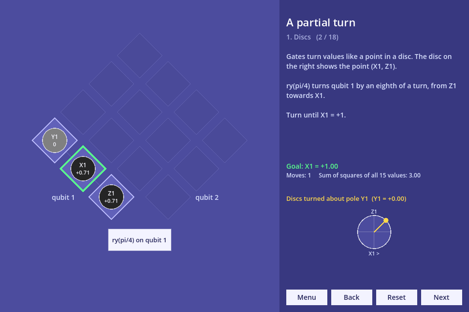
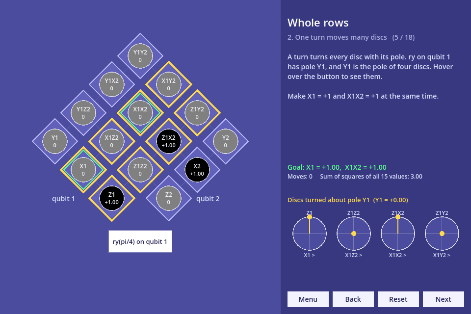
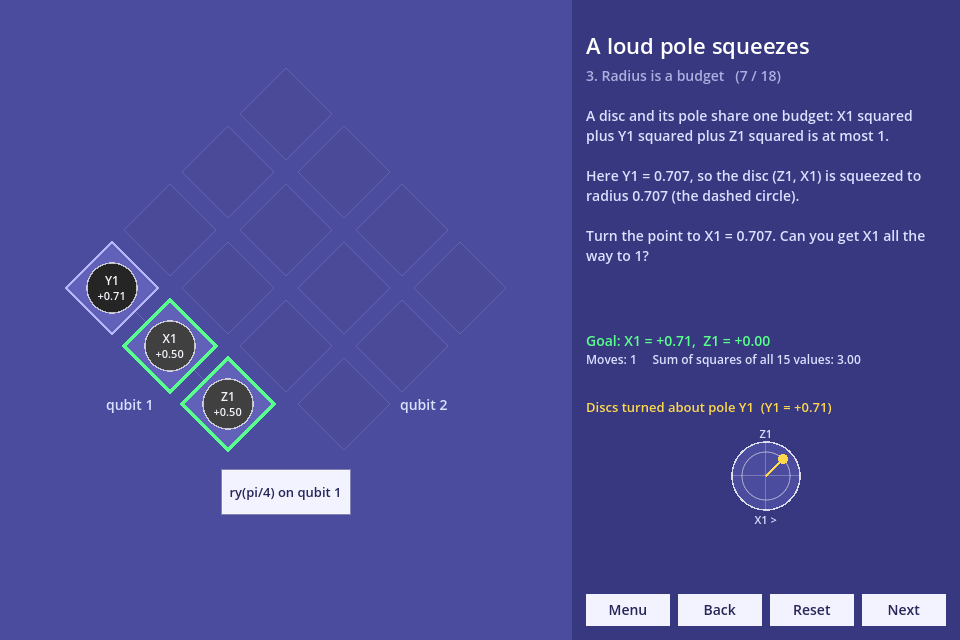
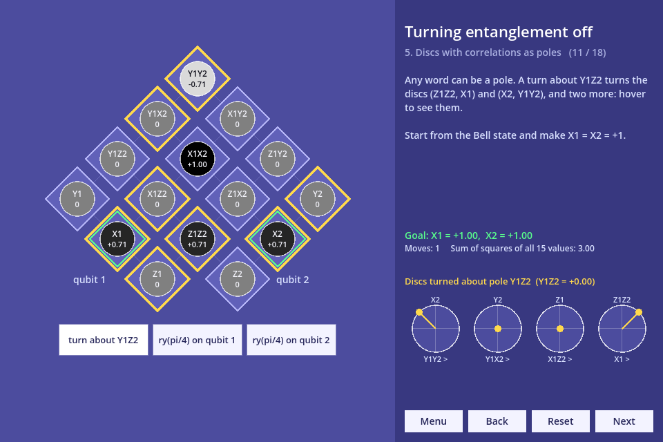
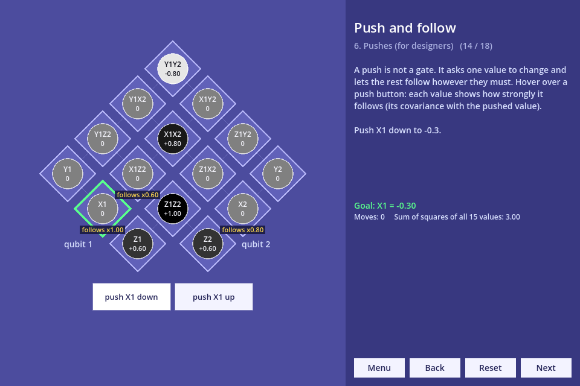

# Remake brief: Hello Qubits and its interdependency tutorial

This repo is a Godot 4 game. This brief is for remaking it as a web app. The two parts are:

1. **Puzzles**: the original 18 Hello Qubits puzzles (`puzzles.gd`, `main.gd`). These are a port of the Hello Qiskit puzzles from the Qiskit textbook.
2. **Interdependency tutorial**: 18 newer puzzles (`tutorial/tutorial.json`, `tutorial.gd`). They show how the 15 values of two qubits depend on each other.

The title screen offers both. Most of this brief is about the tutorial, because it is newer and has more behaviour that is easy to lose.

## Keep these as they are

- **`tutorial/tutorial.json` is the source of truth** for every tutorial puzzle: its text, start state, buttons, goal, solution and closing explanation. The remake should read this file, not copy its content into code, so the content can keep being edited in one place.
- **`TUTORIAL.md` must stay in step with the JSON.** It is the same tutorial written out in full for reading, for teaching, and for AI models. It is generated by `python3 tools/build_tutorial.py`. Keep that script working, or port it.
- **The physics must match `tools/tutorial_engine.py`** exactly (see "Engine" and "Acceptance tests").
- The look of the original: the blue-purple palette, and the diamond grid of circles shaded black (+1), grey (0) and white (-1).

## Engine

The state is a 4-entry complex statevector, starting at |00>. Qubit 1 is the high bit. Port `tools/tutorial_engine.py` (about 140 lines) or `pauli2.gd`; the two are identical.

- **Words and values.** A word is two letters from I, X, Y, Z, with the first letter for qubit 1. The value of word W is <psi|W|psi>. The 15 words are every pair except II. They are shown as names such as `X1Z2` (X on qubit 1, Z on qubit 2) and `Y2` (Y on qubit 2 alone).
- **Turn about pole G by angle theta:** psi -> cos(theta/2) psi - i sin(theta/2) G psi. G is a word, or a weighted sum of anticommuting words that squares to the identity. The h gate uses (X + Z)/sqrt2.
- **Gate library.** In the JSON, a button gives either `gate` (with `qubit`, and `angle_pi` or `angle`) or an explicit `turn` list. Every gate is a list of commuting turns, applied together:
  - x, y, z: a turn by pi about X, Y or Z
  - h: a turn by pi about (X + Z)/sqrt2
  - rx, ry, rz: a turn by theta about X, Y or Z
  - cz: turns about Z1Z2 by -pi/2, Z1 by pi/2 and Z2 by pi/2
  - cx (control qubit 1): turns about Z1X2 by -pi/2, Z1 by pi/2 and X2 by pi/2
- **Push** (`push`, `sign`, `amount`): repeat `amount / 0.01` steps of psi -> normalise(psi - 0.01 (H - <H>) psi), with H = sign x word.
- **Target** (`target` as {word: change}, `poles` as a list of words):
  - The goal is current value + change, clipped to [-1, 1].
  - Iterate up to 200 times:
    - Compute the residual r = goal - value.
    - Stop if |r| < 0.01.
    - Build J[w][g] = -Im <psi| G_g W_w |psi>.
    - Solve (J^T J + 0.001 I) theta = J^T r.
    - Scale theta so that max |theta| <= 0.05.
    - Turn about each pole by its theta.
    - Stop if max |theta| < 1e-6.
- **Discs of a word pole G:** the pairs (P, Q) where P anticommutes with G and Q is the letter-wise product G x P (ignoring the sign). Two words anticommute when the number of qubits where both have a letter (not I) and the letters differ is odd.
- **Covariance** (shown when hovering a push): cov(P, Q) = 1/2 <PQ + QP> - 
<Q>.
- **Goal met:** every goal value within 0.05.

## Screen and behaviour

Reference screenshots of the Godot version are in `docs/remake/`. The layout is 960 x 640 and could be made responsive.

- **Board (left).** One diamond cell per word, at grid position x = b - a, y = a + b, where a and b index the letters of qubits 1 and 2 in the order I, Z, X, Y.
  - Z1 and Z2 are at the bottom, Y1Y2 at the top.
  - Qubit 1's own values run up the left edge, qubit 2's up the right edge.
  - Each cell shows a shaded circle with the word name and the value (2 decimals).
  - Words not in the puzzle's `visible` list are drawn as faint empty cells.
  - Grid lines join visible diagonal neighbours.
  - Labels "qubit 1" and "qubit 2" sit beside Z1 and Z2.
- **Outlines.** Goal cells get a green outline. Cells in `highlight` get pink (the locked twins). While a button is hovered, the cells it can move get yellow: these are the words that anticommute with any of its poles. Goal cells keep an inner green outline while hovered.
- **Buttons** sit under the board, up to 4 per row, labelled from the JSON. Clicking one animates the action over about 0.7 s.
  - Turns are applied in small increments, so circles change shade smoothly and disc points rotate visibly. Do not jump to the end state.
  - Pushes and targets also step visibly.
  - Buttons are disabled while an action runs.
- **Panel (right):**
  - the puzzle title, then "chapter title (n / 18)"
  - the puzzle text (scrollable)
  - the goal line in green ("Goal: explore" when the goal is empty)
  - "Moves: n" and "Sum of squares of all 15 values: 3.00". The sum stays at 3 for pure states, and showing it is part of the lesson.
  - for target buttons, a status line: "X1: wanted +0.25, reached +0.00"
  - the disc view
  - Menu, Back, Reset and Next buttons. Next turns green when the puzzle is solved. Keys: Left/B for Back, Right/N for Next, R for Reset.
- **Disc view (the key teaching element; don't drop it):**

  

  - It shows the discs of one pole as small circles, each with a point: the vertical axis is the first word of the pair (up = +1) and the horizontal axis the second (right = +1). A line runs from the centre to the point.
  - The heading reads "Discs turned about pole Y1 (Y1 = +0.00)".
  - When the pole's value is non-zero, a dashed inner circle of radius sqrt(1 - pole²) shows the disc squeezed (screenshot 3).
  - Which pole is shown:
    - the hovered button's pole, if it has exactly one word pole;
    - otherwise the pole of the last single-pole button pressed;
    - otherwise the puzzle's `discs_pole`.
  - Buttons with several poles (h, cz) show "This button turns about more than one pole at once."
  - Only discs with at least one visible word are shown.

   

- **Push hover.** While a push button is hovered, each visible value with a non-zero covariance shows a small label, "follows x0.80", below its circle, on a dark backing so neighbours don't cover it.

  

- **Success.** When the goal is met, append "Solved!" and the puzzle's `after` text to the panel text, and turn Next green. Players may keep playing, or press Next at any time, including on unsolved puzzles.

## Acceptance tests

`python3 tools/build_tutorial.py --check` replays every puzzle's `solution` (button indices, 0-based) from its `start` and prints the end values. The remake's engine must give the same values (to 3 decimals) for every puzzle. The current end values, in the engine's word notation (`XZ` means X on qubit 1, Z on qubit 2), are:

| # | Puzzle | End values after the solution (non-zero only) |
|---|---|---|
| 1 | Fifteen values | IX 1, XI 1, XX 1 |
| 2 | A partial turn | IZ 1, XI 1, XZ 1 |
| 3 | The third axis | IZ 1, YI 1, YZ 1 |
| 4 | Discs everywhere | (no goal) |
| 5 | Whole rows | IX 1, XI 1, XX 1 |
| 6 | Locality | IZ -1, ZI 0.707, ZZ -0.707, XI 0.707, XZ -0.707 |
| 7 | A loud pole squeezes | IZ 1, XI 0.707, XZ 0.707, YI 0.707, YZ 0.707 |
| 8 | Entanglement takes the budget | ZX -1, XZ 1, YY -1 |
| 9 | Locked twins | IZ 1, YI -1, YZ -1 |
| 10 | Untying | IX 1, ZI 0.707, ZX 0.707, XI 0.707, XX 0.707 |
| 11 | Turning entanglement off | IX 1, XI 1, XX 1 |
| 12 | Turning entanglement on | ZY -1, XZ 1, YX 1 |
| 13 | A cz is three turns | ZX 1, XZ 1, YY 1 |
| 14 | Push and follow | IZ 0.600, IX -0.233, ZI 0.574, ZZ 0.957, XI -0.292, XZ -0.175, XX 0.800, YY -0.765 |
| 15 | Push and compete | IZ 1, ZI 0.946, ZZ 0.946, XI 0.325, XZ 0.325 |
| 16 | Frozen | IX 0.707, ZZ 0.707, XI 0.707, XX 1, YY -0.707 |
| 17 | Asking for a change | IX 0.497, ZZ 0.868, XI 0.497, XX 1, YY -0.868 |
| 18 | Sandbox | (no goal) |

If the JSON changes, regenerate this table from the check output.

The Godot version can be checked the same way: `Godot --headless --path . res://tutorial.tscn -- --test`.

## Out of scope for the remake

- Changing the tutorial's content or wording. Edit `tutorial/tutorial.json` separately, and regenerate `TUTORIAL.md`.
- The Godot-only testing options (`--shot`, `--test`), unless an equivalent is wanted.
